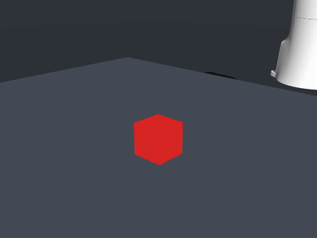

A policy can predict useful actions and still participate in a system that executes them too late. In chunk-based robot control, the engineering problem is not simply inference speed: it is maintaining valid actions while observations age and computation varies.

In robotics, delayed inference can affect motion rather than merely response time. A lower-level controller may continue tracking buffered actions or holding a target while a policy computes. Problems arise when that buffer expires, observations become stale, or the fallback controller cannot maintain acceptable task behaviour. The outcome depends on the control mode, safety system, and task.

I built **[Genesis-Kinetics](https://github.com/Aravind0403/Genesis-Kinetics)** to study that boundary in simulation. The current testbed uses a synthetic action-chunk worker, a scripted Franka Panda task in Genesis World (v1.4.7), injected delays, and timestamped telemetry. It evaluates execution behaviour—not learned-policy capability or hardware safety.

---

## Action-Chunk Buffers and Latency Disturbances

Modern hierarchical embodied control architectures pair perception policies planning intent at 5–10 Hz with low-level controllers running at 100–500 Hz. Recent open-source frameworks (such as LeRobot with Real-Time Chunking [RTC]) adopt **Action Chunking**: the policy outputs an entire future trajectory slice at once (e.g. T = 50 steps, or 500 ms at 100 Hz) rather than single-step actions.

Predicting multiple actions per inference helps decouple execution from model latency. However, action chunking does not automatically solve latency disturbances:

### Why an Injected 150 ms Delay Exhausts a 500 ms Horizon

A 500 ms nominal chunk horizon does not mean the robot always has 500 ms of safety buffer. Consider the timing in an asynchronous pipeline:

```text
Concrete Timing Breakdown in the Testbed:
1. Action Chunk Horizon:              50 steps (500 ms at 100 Hz)
2. Nominal Worker Computation Delay:  80 ms (8 steps truncated upon arrival)
3. Initial Valid Horizon:             42 steps (420 ms of executable trajectory)
4. Update Trigger Policy:             Next request initiated when horizon drops to 15 steps (150 ms remaining)
5. Injected Compute Stall:            Worker experiences +150 ms delay (total response time: 230 ms)
6. Outcome at Controller:             Response arrives at 230 ms > 150 ms available buffer
                                      --> Buffer starvation occurs (80 ms gap at depth 0)
```

When an unexpected compute delay (due to attention prefill bursts, device transfers, or thread scheduling contention) causes the buffer to run dry, the controller must decide how to handle the starved interval. 

---

## System Architecture: The Decoupled Testbed

Genesis-Kinetics decouples the system into two independent processes communicating via shared memory without acquiring OS mutexes in the control hot path:

```
┌─────────────────────────────────────────────────────────────────────────────┐
│                       Synthetic Action-Chunk Worker                         │
│                      (Configurable Computation Delays)                      │
│                                                                             │
│  Scripted Trajectory Generator ──► Parameterized Latency Distribution       │
│                                    (Gaussian, Log-Normal, Injected Stalls)  │
└──────────────────────────────────────┬──────────────────────────────────────┘
                                       │
                                       ▼ Timestamped Action Chunk {t_obs, seq_id, chunk[50, 7]}
                                       │
┌──────────────────────────────────────┴──────────────────────────────────────┐
│                   Double-Buffered Shared-Memory Transport                   │
│                  (POSIX Shared Memory, Non-Blocking Hot Path)               │
└──────────────────────────────────────┬──────────────────────────────────────┘
                                       │
                                       ▼
┌─────────────────────────────────────────────────────────────────────────────┐
│                            Control-Loop Process                             │
│                   (Genesis World Simulation Step @ 100 Hz)                  │
│                                                                             │
│   Chunk Time-Alignment ──► Trajectory Blending / Fallback ──► Genesis Step   │
│   (Drop Elapsed Steps)     (Exponential Blend / Damping)    (Franka Panda)  │
│                                                                      │      │
│                            [In-Process DLPack Tensor Interop] ◄──────┘      │
└──────────────────────────────────────┬──────────────────────────────────────┘
                                       │ Non-blocking Socket (/tmp/rtm.sock)
                                       ▼
┌─────────────────────────────────────────────────────────────────────────────┐
│                            Timestamped Telemetry                            │
│                                                                             │
│     Binary .tick Recorder ──► Trace Inspector ──► Web Dashboard             │
│     Events: [INGEST, IPC_HANDOVER, MOTOR_TICK, QUEUE_DEPTH, TORQUE_NORM]    │
└─────────────────────────────────────────────────────────────────────────────┘
```

> **IPC Transport Note:** The prototype uses double-buffered shared-memory slots and monotonic sequence counters to avoid OS mutexes on the control hot path. Cross-process atomicity, publication ordering, and slot-reuse correctness have not yet been formally established; it is an experimental reference transport rather than a verified lock-free queue.

---

## Three Engineering Components

### 1. Elapsed-Step Truncation & Exponential Blending

When an action chunk arrives at the motor controller, time has elapsed during worker computation. Assuming action index zero corresponds to the observation capture timestamp and the timebases are aligned, Genesis-Kinetics inspects the capture timestamp and truncates the elapsed slice:

```text
elapsed_steps = floor((t_current - t_obs_captured) / Δt)
```

When stitching the remaining future horizon with the currently executing trajectory, abruptly switching chunks causes target position discontinuities. We blend the overlapping slice using exponential decay weights:

```text
q_blended[i] = (1 - w_i) * q_active[i] + w_i * q_new[i]
where w_i = 1 - exp(-α * (i + 1))
```

Exponential blending reduces abrupt changes in target positions. It does not by itself guarantee velocity or acceleration continuity; those properties require appropriate boundary conditions and measurement. Differentiating blended positions yields:

```text
q̇ = (1 - w) * q̇_active + w * q̇_new + ẇ * (q_new - q_active)
```

The final `ẇ * (q_new - q_active)` term contributes to the target velocity whenever the active and incoming trajectories diverge.

---

### 2. Smooth Velocity Taper (Quintic Smoothstep Integrated to Position)

If an injected latency stall exhausts the action queue, the controller transitions to a fallback trajectory. Rather than abruptly commanding zero target velocity, Genesis-Kinetics applies a smooth velocity taper using a quintic smoothstep over a chosen stopping interval (T_stop = 0.20s):

```text
s(τ) = 10τ³ - 15τ⁴ + 6τ⁵                 (where τ = t / T_stop ∈ [0, 1])
q̇(t) = q̇_0 * (1 - s(τ))
```

Integrating this velocity taper over time yields the position command (a 6th-degree polynomial in normalized time):

```text
q(t) = q_0 + q̇_0 * T_stop * [ τ - 2.5τ⁴ + 3.0τ⁵ - τ⁶ ]
```

This taper decelerates commanded joint velocity to zero while the controller continues evaluating joint gravity compensation (τ_grav). Note that this trajectory begins with zero commanded acceleration; if the robot is already accelerating when the buffer starves, acceleration continuity at the handover is not assured. Furthermore, gravity compensation alone does not guarantee that a grasped object will not slip under external contact forces or dynamic disturbance.

---

### 3. In-Process DLPack Tensor Sharing

Inside simulation loops, converting physics state tensors to PyTorch tensors can involve copying memory buffers. Genesis-Kinetics benchmarks in-process tensor sharing using PyTorch's DLPack interface (`torch.from_dlpack` with `copy=False` on PyTorch 2.x).

* **Overhead**: Across 25,000 cycles, tensor handover averaged 2.628 µs for the DLPack path versus 3.368 µs for copy-based creation—a saving of 0.740 µs per operation.
* **Scope**: This microbenchmark measures in-process view creation. It demonstrates payload copying avoided, not end-to-end Python heap allocation or garbage-collection pause reductions. A 0.740 µs saving represents a small fraction of a 10 ms (10,000 µs) control loop budget.
* **Upstream Contribution**: I submitted PR #1141 to Genesis's compiler ([Genesis-Embodied-AI/quadrants#1141](https://github.com/Genesis-Embodied-AI/quadrants/pull/1141)) addressing stream synchronization and device memory leaks during zero-copy DLPack ndarray transfers on unified memory architectures.

---

## Quantitative Findings & Trade-Offs

### Benchmark A: Counterfactual Stress-Test Under Injected Stalls (+150 ms)

We evaluated the controller on a 5-phase Franka Emika Panda tabletop pick-and-lift task in Genesis World under an injected +150 ms compute stall workload:

| Configuration | Mean Jerk (rad/s³) | Peak Commanded Torque (N·m) | Waiting / Fallback Occupancy (%) |
| :--- | :---: | :---: | :---: |
| **Sync Baseline (Nominal)** | 63.79 | 29.80 | 4.4% (Waiting) |
| **Sync Baseline (+150ms Stalls)** | **111.85** | 33.35 | 10.0% (Waiting) |
| **Our Async Runtime (Nominal)** | 66.90 | 52.44 | 4.0% (Fallback) |
| **Our Async Runtime (+150ms Stalls)** | **82.38** | 55.54 | 5.2% (Fallback) |

#### Analysis of the Measured Trade-Off

* **Jerk Metric**: Under the reported injected-stall workload, the asynchronous configuration reduced the measured mean jerk metric from 111.85 to 82.38 rad/s³.
* **Commanded Torque Dynamics**: The asynchronous configuration commanded higher peak torque (55.54 N·m vs 33.35 N·m). The reported peak is an aggregate commanded-torque norm across all joints. Per-joint torque and torque-rate measurements are needed to assess constraint compliance against physical limits (e.g. Franka wrist joints 5–7 have a 12 N·m limit).
* **Nominal Baseline Comparison**: In nominal conditions (without injected stalls), the asynchronous configuration showed higher mean jerk (66.90 vs 63.79 rad/s³) and higher peak torque (52.44 vs 29.80 N·m). Overall, the asynchronous configuration improved the reported jerk metric under injected stalls, while showing higher nominal jerk and higher peak torque in both conditions.
* **Controller Occupancy**:
  - *Synchronous waiting occupancy (10.0% under stalls)*: percentage of control cycles spent stalled waiting on inference.
  - *Asynchronous fallback occupancy (5.2% under stalls)*: percentage of control cycles spent executing the velocity taper fallback.

---

### Benchmark B: In-Process DLPack Microbenchmark (25,000 Cycles)

| Pattern | Latency per Tick | Payload Copied | Effective Throughput |
| :--- | :---: | :---: | :---: |
| **Copy-Based Tensor Creation** | 3.368 µs | 33.38 MB | 396.4 MB/s |
| **DLPack Pointer Sharing** | **2.628 µs** | **0.00 MB** | **508.0 MB/s** |

---

## Timestamped Flight Recorder & Diagnostic Tooling

The flight recorder helps investigate the relationship between action age, buffer starvation, controller state, and simulated task outcomes. A trace can identify candidate failure mechanisms; stronger causal attribution requires controlled comparisons.

The displayed 40-byte binary packet records per-tick controller telemetry:

```c
struct TickPacket {
    uint64_t tick_id;
    double   t_obs;          // Observation capture timestamp (microseconds)
    double   t_motor;        // Motor execution timestamp
    int32_t  buffer_horizon; // Remaining unexecuted actions in queue
    uint32_t state;          // NOMINAL, BLENDING, DAMPED_FALLBACK, BUFFER_EMPTY
    float    torque_norm;    // Commanded L2 torque norm (N·m)
    float    jerk;           // Estimated joint jerk (rad/s³)
};
```

*Note: Per-tick packets capture controller state, buffer depth, and torque estimates. Upstream chunk sequence IDs and worker timing are recorded at the worker layer.*

### Illustrative Diagnostic Scenario (Candidate Mechanism Identification)

```
[ILLUSTRATIVE SCENARIO: OBSERVED PAYLOAD SLIPPAGE AT t = 1.84s]
├── Step 142 (t = 1.42s): Upstream worker begins simulated inference delay.
├── Step 157 (t = 1.57s): Injected stall delays chunk arrival by +150 ms.
├── Step 168 (t = 1.68s): Buffer horizon drops to 0. Controller enters DAMPED_FALLBACK.
└── Step 184 (t = 1.84s): Object slip coincides with prolonged buffer starvation.
└── Candidate Failure Mechanism: Action starvation under compute delay (requires controlled ablation to verify).
```

---

## Conclusion & Code

In chunk-based robot control, maintaining valid actions across compute delays is a fundamental systems challenge. Before scaling policies to physical hardware, robotics teams need testbeds that can measure execution trade-offs under latency disturbances and provide telemetry when timing failures arise.

The full codebase, Genesis tabletop simulation rollout, and interactive web dashboard are open-source on GitHub:

🔗 **GitHub Repository:** [https://github.com/Aravind0403/Genesis-Kinetics](https://github.com/Aravind0403/Genesis-Kinetics)
