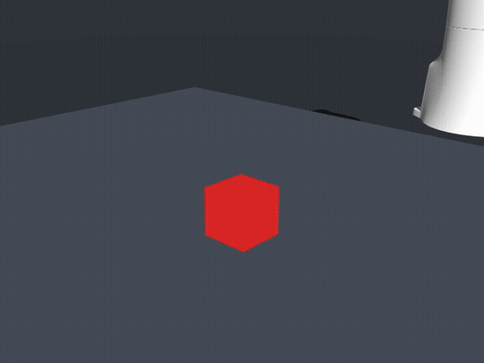

In cloud LLM serving, latency is a user-experience problem. If a model pauses for 150 ms mid-generation, a user merely waits slightly longer for the next token to appear on their screen.

In physical robotics and embodied simulation, **latency is kinetic**.

A robotic arm—like the 7-DOF Franka Emika Panda—has mass, mechanical inertia, momentum, and is continuously subjected to Earth's $9.81\text{ m/s}^2$ gravitational acceleration. If a computer controlling a robotic motor stops sending commands for even 100 milliseconds, physical forces take over: the arm collapses downward under gravity, motor gear teeth grind under sudden deceleration, or a grasped fragile payload slips from the gripper.

The core challenge of modern Vision-Language-Action (VLA) architectures is that the **Brain and the Muscles run at fundamentally incompatible frequencies**:
* **The Brain (VLA / Foundation Policy):** 5 to 10 Hz (Takes 100–200 ms to tokenize camera images, run transformer self-attention, and denoise action tokens).
* **The Muscles (Actuators / Motor Controller):** 100 to 1000 Hz (Requires smooth, continuous torque commands every 1 to 10 ms to maintain mechanical stability under load).

To study how high-frequency control loops behave when upstream perception policies suffer compute stalls, I built **[Genesis-Kinetics](https://github.com/Aravind0403/Genesis-Kinetics)** — an open-source experimental asynchronous action-chunk runtime and timestamped flight recorder built natively on **Genesis World** (v1.4.7) and **Quadrants JIT**.

Here is what happens when you push asynchronous foundation policies into closed-loop physics simulation, why naive execution breaks, and how we engineered the interface.

---

## The Failure Modes: The "Synchronous Freeze" and the Diagnostic Blindspot

Most early VLA evaluation scripts operate in a single synchronous loop:

```
[Camera Ingest] ──► [Wait 150ms for Model] ──► [Step Robot for 500ms] ──► [Freeze & Repeat]
```

This synchronous execution introduces two major failure modes:

### 1. The Synchronous Freeze
Because the robot halts all motor execution while waiting for the next inference pass to finish, the arm exhibits a stepped, stuttering motion. In dynamic manipulation tasks (e.g., catching a moving object or continuous surface wiping), this velocity discontinuity destroys momentum and causes task failure.

### 2. Action Starvation Under P99 Tail Latency
To eliminate the freeze, recent frameworks (like LeRobot with Real-Time Chunking [RTC]) adopt **Action Chunking**: the model predicts an entire future trajectory horizon ($T = 50$ steps, or $500\text{ ms}$ at 100 Hz) in one forward pass.

While chunking buys the robot a 500 ms buffer window, it creates a new vulnerability: **tail latency**.
If the vision-language backbone experiences a P99 compute spike (+150 ms delay due to KV-cache allocation, host-device memory copying, or OS scheduler preemption), the action buffer runs completely dry. Naive controllers drop commanded velocity to zero, triggering an abrupt mechanical shock ($111.85\text{ rad/s}^3$ jerk) and dropping grasped objects.

### 3. The Diagnostic Blindspot
When an autonomous robot drops an object in simulation, robotics researchers traditionally assume the neural network output a bad prediction. Weeks are spent retraining weights or gathering new demonstration data. In reality, **a significant fraction of simulation failures are caused by host OS scheduler jitter, buffer starvation, or missed 10 ms control deadlines**. Without microsecond-level flight telemetry, teams cannot isolate the causal root cause.

---

## System Architecture: The Decoupled Runtime

Genesis-Kinetics decouples the system into two independent processes communicating via shared memory without acquiring OS mutexes in the control hot path:

```
┌─────────────────────────────────────────────────────────────────────────────┐
│                       Synthetic Action-Chunk Worker                         │
│                      (Configurable Computation Delays)                      │
│                                                                             │
│  Scripted Trajectory Generator ──► Parameterized Latency Distribution       │
│                                    (Gaussian, Log-Normal, Injected Stalls)  │
└──────────────────────────────────────┬──────────────────────────────────────┘
                                       │
                                       ▼ Timestamped Action Chunk {t_obs, seq_id, chunk[50, 7]}
                                       │
┌──────────────────────────────────────┴──────────────────────────────────────┐
│                   Double-Buffered Shared-Memory Transport                   │
│                  (POSIX Shared Memory, Non-Blocking Hot Path)               │
└──────────────────────────────────────┬──────────────────────────────────────┘
                                       │
                                       ▼
┌─────────────────────────────────────────────────────────────────────────────┐
│                            Control-Loop Process                             │
│                   (Genesis World Simulation Step @ 100 Hz)                  │
│                                                                             │
│   Chunk Time-Alignment ──► Trajectory Blending / Fallback ──► Genesis Step   │
│   (Drop Elapsed Steps)     (Exponential Blend / Damping)    (Franka Panda)  │
│                                                                      │      │
│                            [In-Process DLPack Tensor Interop] ◄──────┘      │
└──────────────────────────────────────┬──────────────────────────────────────┘
                                       │ Non-blocking Socket (/tmp/rtm.sock)
                                       ▼
┌─────────────────────────────────────────────────────────────────────────────┐
│                            Timestamped Telemetry                            │
│                                                                             │
│     Binary .tick Recorder ──► Trace Inspector ──► Web Dashboard             │
│     Events: [INGEST, IPC_HANDOVER, MOTOR_TICK, QUEUE_DEPTH, TORQUE_NORM]    │
└─────────────────────────────────────────────────────────────────────────────┘
```

---

## The Three Core Engineering Components

### 1. Elapsed-Step Truncation & Exponential Ensembling

When a fresh action chunk arrives at the motor controller, time has elapsed during inference. If observation capture occurred at $t = 1000\text{ ms}$, and inference completed at $t = 1120\text{ ms}$, exactly 12 steps (120 ms at 100 Hz) are already obsolete.

Genesis-Kinetics inspects the capture timestamp and dynamically truncates the elapsed slice:
$$\text{elapsed\_steps} = \left\lfloor \frac{t_{\text{current}} - t_{\text{obs\_captured}}}{\Delta t} \right\rfloor$$

When stitching the remaining future horizon with the currently executing trajectory, abruptly switching chunks causes a velocity jump. We blend the overlapping slice using exponential decay weights:
$$q_{\text{blended}}[i] = (1 - w_i) \cdot q_{\text{active}}[i] + w_i \cdot q_{\text{new}}[i] \quad \text{where } w_i = 1 - e^{-\alpha (i + 1)}$$

At step 0, $w_0 \approx 0$ (preserving current trajectory velocity). Over subsequent steps, $w_i \to 1.0$, smoothly transitioning into the fresh policy prediction without mechanical vibration.

---

### 2. Quintic Minimum-Jerk Damped Continuation

If an adversarial latency spike (+150 ms) exhausts the action queue, how should the robot decelerate?

Setting the target velocity to zero causes infinite instantaneous acceleration, inducing violent jerk. Instead, Genesis-Kinetics solves a 5th-order minimum-jerk polynomial that drives joint velocities to zero over a critical damping window ($T_{\text{damp}} = 0.20\text{s}$):
$$s(\tau) = 10\tau^3 - 15\tau^4 + 6\tau^5 \quad \text{where } \tau = \frac{t}{T_{\text{damp}}} \in [0, 1]$$
$$q(t) = q_0 + \dot{q}_0 \cdot T_{\text{damp}} \cdot \left[ \tau - \frac{10}{4}\tau^4 + \frac{15}{5}\tau^5 - \frac{6}{6}\tau^6 \right]$$

Crucially, while joint velocities are smoothly decelerated, the controller **actively sustains joint gravity compensation ($\tau_{\text{grav}}$)**. The robot holds any grasped payload securely in the air instead of collapsing into unpowered compliance.

---

### 3. In-Process DLPack Zero-Copy Tensor Sharing

Inside high-frequency simulation loops, allocating intermediate NumPy arrays to copy physics state tensors into PyTorch introduces heap churn and triggers Python Garbage Collection pauses.

Genesis-Kinetics implements in-process zero-copy tensor sharing via the DLPack protocol (`torch.from_dlpack` with `copy=False`). 

> **Upstream Compiler Integration:**  
> This builds directly on our upstream contribution to Genesis's compiler ([Genesis-Embodied-AI/quadrants#1141](https://github.com/Genesis-Embodied-AI/quadrants/pull/1141)), which fixed device staging memory leaks and synchronized PyTorch streams during zero-copy DLPack ndarray transfers on unified memory architectures (Apple Silicon Metal).

---

## Quantitative Findings & Trade-Offs

### Benchmark A: Counterfactual Stress-Test Under Injected Stalls (+150 ms)

We evaluated the controller on a 5-phase Franka Emika Panda tabletop pick-and-lift task in Genesis World under an injected +150 ms compute stall workload:

| Configuration | Mean Jerk ($\text{rad/s}^3$) | Peak Torque ($\text{N}\cdot\text{m}$) | Waiting / Fallback Occupancy (%) |
| :--- | :---: | :---: | :---: |
| **Sync Baseline (Nominal)** | 63.79 | 29.80 | 4.4% (Waiting) |
| **Sync Baseline (+150ms Stalls)** | **111.85** | 33.35 | 10.0% (Waiting) |
| **Our Async Runtime (Nominal)** | 66.90 | 52.44 | 4.0% (Fallback) |
| **Our Async Runtime (+150ms Stalls)** | **82.38** | 55.54 | 5.2% (Fallback) |

#### The Continuity-vs-Effort Trade-Off
Under injected +150 ms stalls:
* **26.3% Reduction in Mechanical Jerk**: The synchronous baseline freezes in place, causing violent joint velocity discontinuities ($111.85\text{ rad/s}^3$). Our asynchronous runtime blends overlapping steps and transitions into quintic deceleration ($82.38\text{ rad/s}^3$).
* **Torque Dynamics**: The asynchronous runtime commands higher peak torque ($55.54\text{ N}\cdot\text{m}$ vs $33.35\text{ N}\cdot\text{m}$). This is an intentional control trade-off: rather than freezing position commands or dropping into unpowered compliance (which causes payloads to slip under gravity), the controller commands dynamic braking torque while actively sustaining joint gravity compensation. Peak torque remains comfortably within the Franka Panda physical limits (Joints 1–4: 87 N·m).

---

### Benchmark B: In-Process DLPack Microbenchmark (25,000 Cycles)

| Pattern | Latency per Tick | Bytes Copied | Effective Throughput |
| :--- | :---: | :---: | :---: |
| **Copy-Based Tensor Creation** | 3.368 µs | 33.38 MB | 396.4 MB/s |
| **DLPack Pointer Sharing** | **2.628 µs** | **0.00 MB** | **508.0 MB/s** |

* **0.740 µs Overhead Reduction**: Avoids intermediate buffer copies ($3.368\,\mu\text{s} \to 2.628\,\mu\text{s}$).
* **Heap Churn Avoidance**: Eliminates 33.4 MB of temporary Python heap allocations over 25,000 cycles, helping mitigate Python garbage collection pauses during 100 Hz control loops.

---

## Timestamped Flight Recorder & Causal Telemetry

The core observability contribution is the **Timestamped Flight Recorder** (`telemetry/rtm_probe.py`). Every 10 ms, the motor loop streams a compact 40-byte binary `.tick` packet over a local Unix Domain Socket (`/tmp/rtm.sock`):

```c
struct TickPacket {
    uint64_t tick_id;
    double   t_obs;          // Observation capture timestamp (microseconds)
    double   t_motor;        // Motor execution timestamp
    int32_t  buffer_horizon; // Remaining unexecuted actions in queue
    uint32_t state;          // NOMINAL, BLENDING, DAMPED_HOLD, BUFFER_EMPTY
    float    torque_norm;    // Commanded L2 torque norm (N·m)
    float    jerk;           // Estimated joint jerk (rad/s³)
};
```

### Isolating Causal Root Causes

When a robot fails to grasp or lift an object in simulation, the flight recorder allows engineers to inspect the temporal correlation between compute stalls and physical state transitions:

```
[SCENARIO: OBSERVED PAYLOAD SLIPPAGE AT t = 1.84s]
├── Step 142 (t = 1.42s): Upstream worker begins simulated inference delay.
├── Step 157 (t = 1.57s): Injected stall delays chunk arrival by +150 ms.
├── Step 168 (t = 1.68s): Buffer horizon drops to 0. Controller enters DAMPED_FALLBACK.
└── Step 184 (t = 1.84s): Object slip coincides with prolonged buffer starvation.
└── Candidate Failure Mechanism: Action starvation under compute delay (requires controlled ablation to verify).
```

---

## Conclusion & Code

Deterministic latency is an unsung prerequisite for scaling embodied foundation models from simulation to physical hardware. Before you can trust a multi-billion parameter VLA to manipulate fragile objects, you need an infrastructure layer that can absorb compute jitter, prevent mechanical shock during stalls, and provide microsecond-precision causal telemetry when things go wrong.

The full codebase, Genesis tabletop simulation rollout, and interactive web dashboard are open-source on GitHub:

🔗 **GitHub Repository:** [https://github.com/Aravind0403/Genesis-Kinetics](https://github.com/Aravind0403/Genesis-Kinetics)
